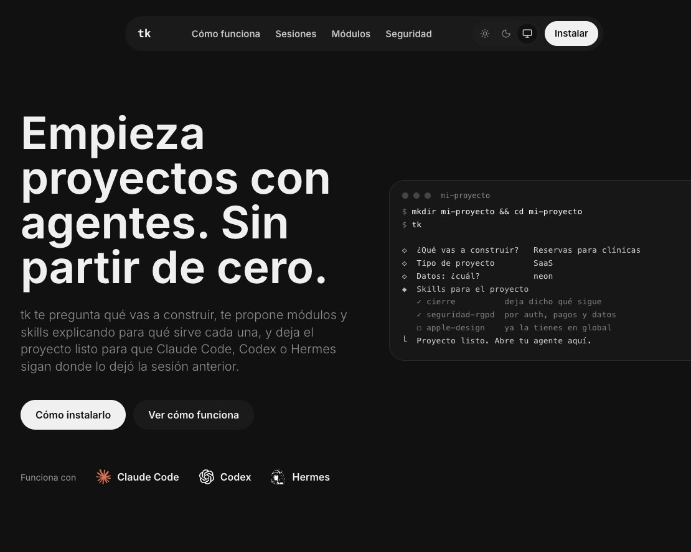

# tk: landing

Web de [tk](https://github.com/manuelt15/toolkit-public), un comando para empezar proyectos
con agentes de IA (Claude Code, Codex y Hermes).

**En vivo:** [toolkit-landing-delta.vercel.app](https://toolkit-landing-delta.vercel.app)



## Qué cuenta

- **Por qué existe:** tk nace de cómo trabajo con agentes y se publica por si le sirve a
  alguien más. Lista los autores de las skills de terceros, sacados del catálogo.
- **Cómo funciona:** el asistente pregunta lo justo, explica cada skill y deja el proyecto
  listo para el agente.
- **Sesiones:** `tk start` al empezar y `tk close` al terminar, con un handover para la
  siguiente sesión.
- **Módulos y tipos de proyecto:** qué da y qué cuesta cada módulo.
- **Seguridad:** sin telemetría, comandos de terceros siempre a la vista y emails fuera
  del proyecto.
- **Instalar** y preguntas frecuentes.

Todo lo que dice de módulos, tipos de proyecto y skills sale de `content/catalog.json`, una
copia del catálogo real del paquete. Así la web no promete nada que tk no tenga.

## Stack

Next.js 16 (App Router, estática), React 19, Tailwind CSS 4, shadcn sobre Radix e iconos
de lucide. Fuente Inter servida desde el propio sitio con `next/font`.

## Desarrollo

Requisitos: Node 22 o superior.

```bash
npm install
npm run dev      # http://localhost:3000
npm run lint
npm run build
```

## Cómo está hecha

| Ruta | Qué es |
|---|---|
| `app/page.tsx` | Toda la página: secciones, pasos, módulos, instalar y preguntas |
| `app/layout.tsx` | Metadatos, fuente y script de tema (sin parpadeo) |
| `app/icon.svg` | Favicon, con variante para tema oscuro |
| `components/site/` | Navegación, terminal y selector de tema |
| `content/catalog.json` | Catálogo de tk (copiar desde `toolkit-public/catalogo/` al cambiar) |
| `DESIGN.md` | Sistema de diseño: tokens, tipografía y reglas. Toda la UI sale de aquí |

- **Tema claro, oscuro o del sistema**, guardado en el navegador del visitante.
- **Sin cookies, analítica ni formularios.** Cabeceras de seguridad en `next.config.ts`.
- **`NPM_LIVE`** en `app/page.tsx`: `true` desde que tk está en npm. Con `false`, la
  sección de instalar dice "Pronto en npm" y se ocultan los enlaces al repo y al paquete.

## Despliegue

Vercel, desde `main`. Es una web estática: no necesita variables de entorno.
